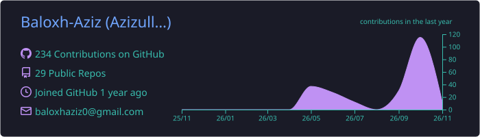
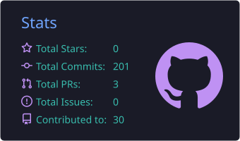

# Hey there! I'm Azizullah Asad 👋

🎓 BS Data Science Student | Dawood University of Engineering & Technology, Karachi

🚀 Building projects that turn raw data into real insights

🌱 Currently exploring Machine Learning & Data Visualization

---

## 🛠️ What I Work With

---

## 📂 Featured Projects

### 🚨 [Crime Rate Prediction](https://github.com/Baloxh-Aziz/Crime-Rate-Prediction)
Machine Learning app built with **Random Forest** & **Streamlit** on **270,000+ real crime records**.
`Python` `Pandas` `Scikit-learn` `Streamlit`

### 🔫 [Weapon Detection (YOLOv11)](https://github.com/Baloxh-Aziz/Weapon-Detection-Yolov11)
Object detection model trained with **YOLOv11** to detect weapons, with an app for running it on images/video.
`Python` `YOLOv11` `Computer Vision`

### 🤖 [RAG Pipeline](https://github.com/Baloxh-Aziz/Rag_Pipeline)
Retrieval-Augmented Generation app that answers questions from your own documents.
`Python` `LLM` `RAG`

---

## 📊 GitHub Stats

---

## 📫 Let's Connect

---

💬 *"Every dataset has a story — I'm here to find it."*
